<div align="center">


# netrunner-agents

**Your Claude Code subagents, as tiny pixel mascots. A small cyberpunk pane that shows who's working, what they're doing, for how long, and exactly how many tokens they're burning.**

I kept spinning up subagents and then just… staring at a spinner, wondering what they were up to. So I made them a little crew instead.

**[Try the live demo →](https://nocashflow.github.io/claude-netrunner-agents/)**

[](CHANGELOG.md)
[](LICENSE)
[](https://code.claude.com/docs/en/plugins/mods/overview)
[](#meet-the-crew)
[](#accessibility)
[](#security-and-privacy)
[](https://github.com/nocashflow/claude-netrunner-agents/actions/workflows/audit.yml)

[Website](https://nocashflow.github.io/claude-netrunner-agents/) · [Install](#install) · [The pane](#what-you-get) · [Meet the crew](#meet-the-crew) · [Make them yours](#make-them-yours) · [Usage](#usage) · [Performance](#light-on-your-machine) · [Security](#security-and-privacy) · [FAQ](#faq)

</div>

---

## Why I made this

When Claude Code splits a big job between subagents, you mostly get a spinner and a "done" at the end. I wanted to actually *see* the crew: who's jacked in, which file they're poking at, how long they've been at it, and how many tokens they're chewing through. Bonus points if it looked like something out of Night City instead of a spreadsheet.

So this is that. It's a little pane that sits next to your chat. Every subagent shows up as a pixel mascot with its live tool, a token bar and a timer. When it's done it tucks itself into a slim row, and if it crashes it glitches out so you can't miss it.

I'm still learning how Claude Code mods work, so this is me figuring things out in public. If something's off, tell me. Seriously.

## Install

**In the Claude Code desktop app:** click **+** next to the message box, then **Plugins** → **Add marketplace**, and enter:

```
nocashflow/claude-netrunner-agents
```

Then **Add plugin** → **netrunner-agents**.

**In a terminal session**, type this at the prompt:

```
/plugin install netrunner-agents --marketplace nocashflow/claude-netrunner-agents
```

Say `y` to add the marketplace and pick a scope. I'd go with **user**, so it works in every project (and in the desktop app too). **From a shell**, it's:

```bash
claude plugin install netrunner-agents --marketplace nocashflow/claude-netrunner-agents
```

That's it, no ripperdoc needed. The pane opens on its own the first time Claude starts an agent, or you can open it any time with:

```
/netrunner
```

> [!NOTE]
> Made for the Claude Code **desktop app** (Code tab), v2.1.325 or later. It runs in the terminal and VS Code too, but there the mascots become coloured blocks, since those can't draw pictures in a pane.

## What you get

<table>
  <tr>
    <td width="52%">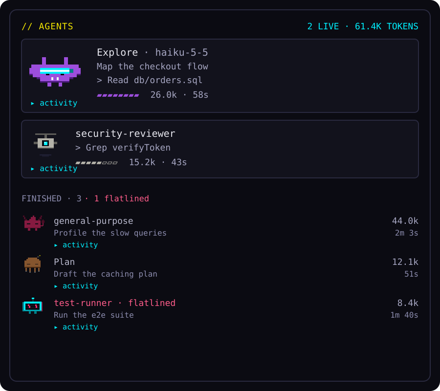</td>
    <td>

**Live agents** get a tile: the mascot, the agent type, the model, what it was asked to do, the tool it's running *right now* and a token bar with a timer that counts up.

**▸ activity** under any agent opens its last 8 tool calls, and once it's done, the start of its final report.

**Finished agents** shrink into slim rows with how many tokens they used and how long they took. Older ones fold into a strip of tiny icons, so the pane never grows forever.

**Flatlined agents** (errors, aborts) glitch out and turn red, with the word *flatlined* next to them, so it's never colour alone.

**Minimized**, it becomes a one-line widget of the live crew and the total.

</td>
  </tr>
</table>

**About the token number:** it's the size of the agent's latest request (input + cache + output) exactly as the API reported it. It's the same number Claude Code shows when an agent finishes, so they'll match.

## Meet the crew

Eight mascots, all drawn from scratch in chunky pixel art. Each one turns up for certain agent types by default. Anything else gets Proc or Shell, picked from the agent's name, so the same agent always looks the same.

<table>
  <tr>
    <td width="25%" align="center">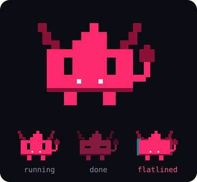<br><b>Daemon</b> · <code>general-purpose</code><br><sub>A tiny horned imp. Background processes are literally called daemons, so every subagent is one.</sub></td>
    <td width="25%" align="center">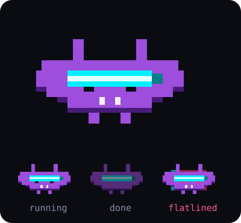<br><b>Ping</b> · <code>Explore</code><br><sub>A pixel bat. Sends out a ping and listens for what comes back, like any good search.</sub></td>
    <td width="25%" align="center">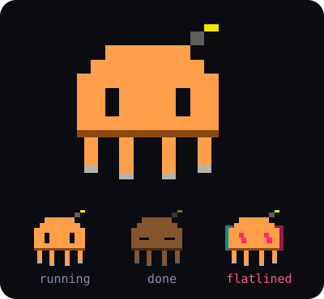<br><b>Node</b> · <code>Plan</code><br><sub>A squishy data-squid whose tentacles are network cables, plugs and all. Wired into everything.</sub></td>
    <td width="25%" align="center">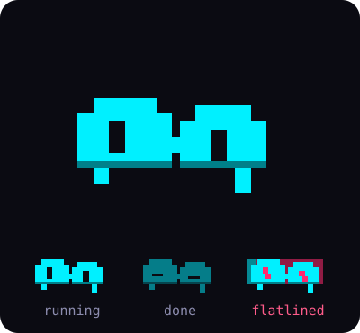<br><b>Fork</b> · <code>fork</code><br><sub>A slime halfway through splitting in two, like a forked process.</sub></td>
  </tr>
  <tr>
    <td align="center">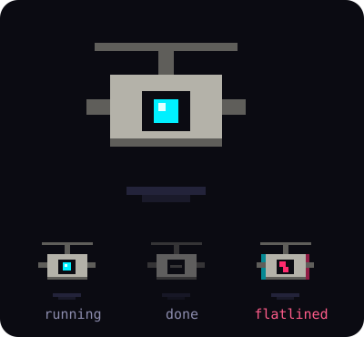<br><b>Sentry</b> · <sub>reviewers, audits, security</sub><br><sub>A hovering drone with one big lens. Keeps watch over long jobs and code reviews.</sub></td>
    <td align="center">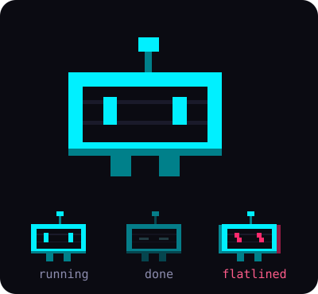<br><b>Byte</b> · <sub>tests, builds, lint</sub><br><sub>A walking CRT terminal. Its face is the screen, scanlines and all.</sub></td>
    <td align="center">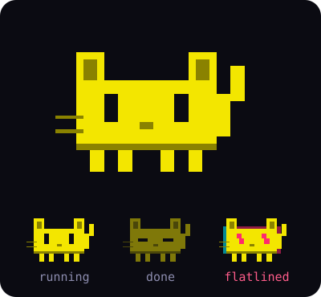<br><b>Proc</b> · <sub>everyone else</sub><br><sub>A blocky street cat. Quick, curious, always poking at files.</sub></td>
    <td align="center">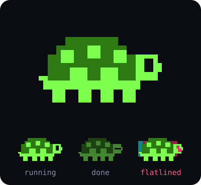<br><b>Shell</b> · <sub>everyone else</sub><br><sub>A turtle named after the command line. Slow, steady, never loses its place.</sub></td>
  </tr>
</table>

## Make them yours

Every agent type can wear any mascot, in any of 7 colours, with any of 9 bits of chrome. Your picks are saved, so they stick around in every chat.

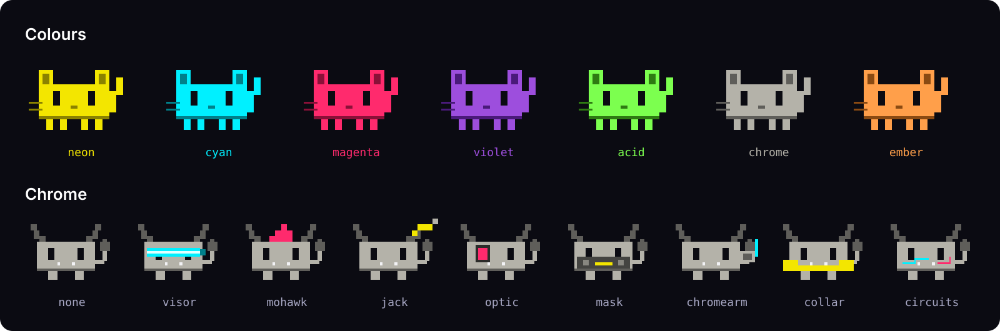

```
/netrunner style Explore node acid visor
```

Give it the agent type, then any mix of a mascot, a colour and a cosmetic, in any order. Leave one out and it keeps what it had. Some combos I like:

| Command | Result |
| --- | --- |
| `/netrunner style general-purpose daemon ember mohawk` | an orange punk imp |
| `/netrunner style Explore proc cyan visor` | a netrunner cat |
| `/netrunner style code-reviewer sentry neon chromearm` | a yellow drone with a chrome arm |
| `/netrunner style test-runner byte magenta optic` | a pink CRT with a red cybereye |

## Usage

| Command | What it does |
| --- | --- |
| `/netrunner` | Opens the Agents pane. |
| `/netrunner close` | Closes it. It stays closed (even when new agents start) until you open it again. |
| `/netrunner clear` | Clears out finished agents. |
| `/netrunner looks` | Shows who wears what, plus every mascot, colour and cosmetic. |
| `/netrunner style <type> [mascot] [colour] [cosmetic]` | Restyles an agent type. Any order, any of them. |
| `/netrunner reset <type>` | Puts an agent type back to its default look. |

> [!TIP]
> Minimize the pane and it turns into a tiny widget with just the live crew and the total, nice if you want to keep an eye on things without giving up the space.

## Light on your machine

I really didn't want a fun little pane to be the thing that makes your laptop fans spin up, so I was pretty strict about this:

- **No animation.** The mascots are still pictures. Each look is built once and reused, about 1–2 KB each.
- **Batched updates.** All agents' updates get grouped into one write every 250 ms, and a batch that changes nothing writes nothing. So the pane redraws about **4 times a second at most**, and only while agents are actually working.
- **A lazy timer.** The timer ticks once a second, and only while an agent runs *and* the pane is open. When the last agent finishes, it switches itself off.
- **Nothing polls.** Every update comes from an event Claude Code already sends. When no agents are running, the mod does nothing at all.
- **Capped memory.** 8 tool lines per agent, 18 finished agents, and 64 custom looks. That's it.
- **Tiles don't jump around.** Live agents keep the order they started in, so nothing re-lays out every time a number changes.

## Accessibility

- **Contrast:** every text colour in the pane is at least **4.5:1** (WCAG 2.2 AA) against the pane, the tiles and the app's own dark backgrounds. Most of them are well past 7:1. The audit checks this on every push.
- **Never colour alone:** a flatlined agent is red *and* says "flatlined". Finished agents sit under a "FINISHED" label, and live ones are counted in the header.
- **Screen readers:** every mascot has a description, e.g. *"Ping, the Explore agent, running"*. The activity toggle is a real button with a text label.
- **No motion, no flashing:** nothing in the pane moves on its own. The only thing that changes is the numbers and text.
- **Keyboard:** the activity toggles are Claude Code's own buttons, not something custom, so they work with the keyboard wherever the app's buttons do.

If anything is hard to read or use for you, please [open an issue](https://github.com/nocashflow/claude-netrunner-agents/issues/new/choose). I'd genuinely like to know.

## Security and privacy

Short version: it **watches** your agents and **draws** a pane. It never touches the network, your files or other programs, and it never changes or blocks anything an agent does. No corpo spyware, no daemons doing shady stuff in your deck (just cute ones).

- **What it reads:** each subagent's type, model, task description, the tools it calls (and their arguments), its token usage and its final answer. That's everything the pane shows, and that's all it uses.
- **Where that goes:** nowhere. It lives in your session's memory and disappears when the session ends. The only thing saved to disk (in Claude Code's own plugin storage) is your custom mascot looks.
- **Secrets get masked:** before anything is even stored, API keys, tokens, `Bearer` headers, passwords in commands, `user:password@` in URLs and private keys are swapped for `•••`. For web fetches it only keeps the host, never the path or query. It's a safety net, not a guarantee, but it means a token in a command won't sit in the pane in plain sight.
- **Plain text only:** everything from an agent is drawn as plain text, cut short, with control characters stripped. No Markdown, no links, nothing clickable.
- **Mascots are dumb pictures:** they're built only from fixed shapes and colours. Nothing you type (an agent name, a style) ever ends up inside an SVG. Saved looks are checked against the known names when they load, so a tampered file can't sneak anything in.
- **Never in the way:** every hook just observes and passes things through. If the mod ever errors, Claude Code skips it and carries on, so it can't block an agent, a tool call or a prompt.
- **What it's allowed to do:** `claude plugin validate plugins/netrunner-agents` lists every capability:
  - registering `/netrunner`;
  - reading and writing its own session state and saved looks;
  - opening and closing its own pane;
  - its own timers;
  - reading (never changing) the list of agents, so ones already running when the pane opens show up too.

  No network, file, process, model, tool or MCP access. Zero dependencies.

Found a problem? Please see [SECURITY.md](SECURITY.md) and report it privately.

## How it works

It's a Claude Code **mod**: a small TypeScript module that Claude Code loads when a session starts ([docs](https://code.claude.com/docs/en/plugins/mods/overview)).

```
agent.spawn    ──▶ a subagent starts: add its tile, open the pane
tool.call      ──▶ it calls a tool: update "what it's doing now" + its activity
turn.step      ──▶ a model request finishes: update its tokens
turn.complete  ──▶ it's done (or flatlined): move it to the finished rows
ui.render      ──▶ draw the pane
```

Every hook calls `next()` and hands back exactly what it got, so it never changes how agents behave.

```
.claude-plugin/
  marketplace.json         the marketplace: lists the mod below
plugins/netrunner-agents/  the mod itself, the only part that gets installed
  .claude-plugin/          manifest and icon
  hooks/
    register.tsx           the hooks, the /netrunner command and the pane
    mascots.ts             the eight mascots, colours and cosmetics (pure functions)
    privacy.ts             secret masking and text clipping
    palette.ts             the pane's colours
  types/index.d.ts         what the mod keeps in session state
  tests/                   claude plugin test
scripts/
  audit.mjs                accessibility, safety and efficiency checks (runs on every push)
  build-assets.mjs         draws every picture in this README from the real mascot code
assets/                    generated: the film, the crew, the pane, the looks
docs/                      the website (GitHub Pages): index.html, site.css, site.js,
                           plus generated mascots.js, pictures, icon and share card
```

The mascots are plain `<rect>`s on a 64×48 grid. Every cosmetic is placed from each mascot's own eyes, head and body, so a visor or a mohawk fits all eight without any special cases.

## Development

You'll need Node 23.6 or newer. It runs the TypeScript directly, so there's nothing to install:

```bash
npm run audit
```

```bash
npm run build:assets
```

```bash
claude plugin test plugins/netrunner-agents
```

`audit` checks contrast, every mascot combination (all 1,512 of them), the secret masking, what the code can reach, and the efficiency limits. `build:assets` redraws the film and pictures in this README, and the website's mascot code and pictures, from the real mascot code, so run it whenever you touch a mascot. To preview the website, serve the repo folder (for example `python -m http.server`) and open `/docs/`. If you want to add a mascot or a cosmetic, [CONTRIBUTING.md](CONTRIBUTING.md) walks through it.

Want to try your changes live? Clone the repo, open it in Claude Code and ask it to *"install this plugin from this folder instead of the GitHub version"*. Then `/reload-plugins` after each change.

## FAQ

**Can I see what my Claude Code subagents are doing?**
Yes, that's the whole point. Install it, and every subagent Claude starts shows up in the Agents pane with its current tool, its tokens and a timer. Click **▸ activity** to see its last few tool calls.

**Does the token count match Claude Code's?**
Yes. It's the size of the agent's latest request as the API reported it, which is the same number Claude Code prints when an agent finishes.

**Does it slow anything down?**
It shouldn't. The pane redraws about 4 times a second at most, only while agents are working, and the mascots don't animate. See [Light on your machine](#light-on-your-machine).

**Does it see my code or send it anywhere?**
It sees what agents do (tool names and arguments, their final answers) so it can show them to you, but it keeps all of that in memory and never sends anything anywhere. Secrets are masked before they're stored. See [Security and privacy](#security-and-privacy).

**Does it work in the terminal or VS Code?**
The pane and `/netrunner` work, but those can't draw pictures in a pane, so each mascot becomes a coloured block.

**Does it work with the Background tasks panel?**
Yep, they're independent. Background tasks lists the tasks, and this shows the same agents as a crew with tokens and activity. Use whichever you like, or both.

**Can I add my own mascot?**
Yes. They're just a few rectangles in [`mascots.ts`](plugins/netrunner-agents/hooks/mascots.ts). Open the repo in Claude Code and describe the one you want. See [CONTRIBUTING.md](CONTRIBUTING.md).

**Pairs well with?**
My [cyberpunk themes](https://github.com/nocashflow/claude-cyberpunk-themes) for Claude Code, and the pane's colours were picked to sit nicely on them.

## Credits

A fan project, made with a lot of love for the cyberpunk genre and *Cyberpunk: Edgerunners* in particular. All eight mascots are my own pixel art, drawn from scratch. No artwork, logos, fonts or characters from the game, the show or anyone else.

It's unofficial, and not affiliated with or endorsed by Anthropic, CD PROJEKT RED or Studio Trigger. *Cyberpunk* and *Cyberpunk: Edgerunners* are trademarks of their owners.

Released under the [MIT License](LICENSE). Go send your crew in, choom. Stay preem.
